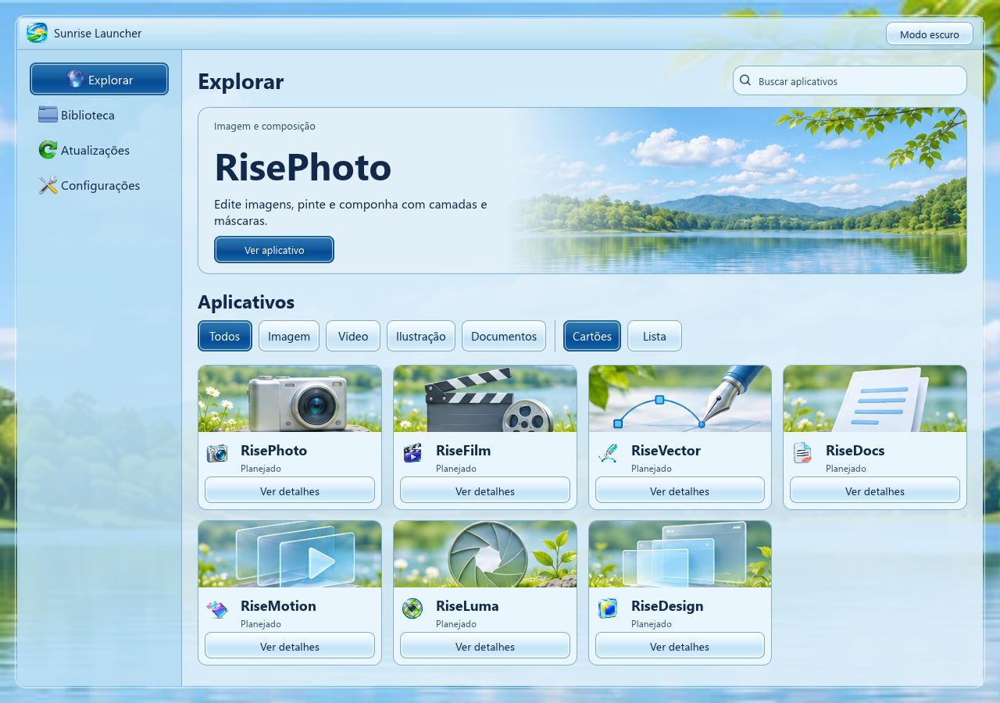

  

<h1 align="center">Sunrise Initiative</h1>

<strong>Ferramentas abertas para criar com liberdade.</strong>

  <a href="https://sunrise-website-orcin.vercel.app/">Site oficial</a> ·
  <a href="https://github.com/Sunrise-Initiative/sunrise-launcher">Sunrise Launcher</a> ·
  <a href="https://github.com/Sunrise-Initiative/sunrise-launcher/blob/main/CHANGELOG.md">Novidades</a> ·
  <a href="https://github.com/Sunrise-Initiative/sunrise-launcher/issues">Contribuir</a>

Construímos um ecossistema de aplicativos desktop de código aberto para imagem, vídeo, design e documentos. Nosso trabalho é orientado por processamento local, controle dos próprios arquivos e interfaces cuidadas, com uma identidade visual inspirada no Frutiger Aero.

### Conheça o Sunrise Launcher

O primeiro aplicativo com código público reúne o catálogo Sunrise, busca, páginas de produtos e uma biblioteca para abrir executáveis locais. É desenvolvido em **Rust**, com **egui, eframe e wgpu**, e oferece temas claro e escuro, navegação por teclado e redução de movimento.

  

A versão **0.2.0** está disponível como código-fonte, com instruções de compilação para Windows. O catálogo e a biblioteca local funcionam offline. Instalação automática e atualizações autenticadas fazem parte das próximas etapas. [Explore o repositório e as instruções de uso](https://github.com/Sunrise-Initiative/sunrise-launcher#readme).

### Aplicativos em planejamento

| Aplicativo | Foco |
| --- | --- |
| **RisePhoto** | Edição de imagens, pintura e composição em camadas |
| **RiseFilm** | Edição de vídeo e montagem |
| **RiseVector** | Ilustração vetorial |
| **RiseDocs** | Leitura, anotação e organização de PDFs |
| **RiseMotion** | Animação, composição e efeitos |
| **RiseLuma** | Organização de fotografias e revelação RAW |
| **RiseDesign** | Criação de peças gráficas |

O desenvolvimento segue a sequência **website → launcher → RisePhoto → RiseFilm**, com os demais aplicativos em etapas posteriores. O **Sunrise OS**, baseado em Linux, integra a visão de longo prazo. A evolução do projeto e o catálogo podem ser acompanhados no [site oficial](https://sunrise-website-orcin.vercel.app/).

### Como trabalhamos

- **Autonomia.** Priorizamos operação local, controle dos arquivos e uso offline.
- **Qualidade de uso.** Desempenho, acessibilidade e consistência visual orientam as decisões.
- **Desenvolvimento aberto.** Código, histórico de alterações e problemas conhecidos acompanham as entregas públicas.

### Participe

Relatos de problemas, sugestões de usabilidade e contribuições ao código ajudam a construir o Sunrise. Para começar, consulte as instruções do launcher e os testes documentados no repositório. Ao reportar uma falha, inclua a versão, o sistema operacional, os passos para reproduzir e o resultado esperado. [Abra ou acompanhe uma issue](https://github.com/Sunrise-Initiative/sunrise-launcher/issues).

O Sunrise Launcher é distribuído sob **GPL-3.0-only**. As licenças e os créditos de recursos de terceiros acompanham o código.
